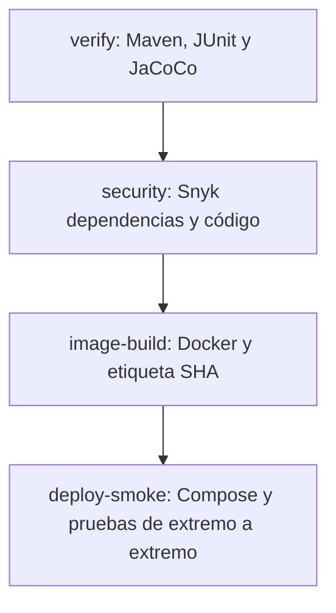

# EduBío 360 — Backend de Microservicios

## EP2 DOY0101 — Ingeniería DevOps

Esta sección documenta **la entrega de Ingeniería DevOps (DOY0101)**, separada
de la EP02 de JVY0101 descrita más abajo. Se utiliza el mismo sistema Java 21:
seis microservicios de negocio, API Gateway, Eureka, MySQL y RabbitMQ.
La meta es acreditar los cinco indicadores (IE1–IE5) con evidencia ejecutable.

### 1. Pipeline y condiciones de calidad

El archivo [`.github/workflows/ci.yml`](.github/workflows/ci.yml) define este flujo:



- En `push` a `main`, `develop`, `feature/**` o `feat/**` se ejecuta la cadena
  completa. En Pull Requests internos dirigidos a `main` o `develop` se ejecutan
  las verificaciones de Maven y Snyk, pero no el despliegue.
- Los jobs `image-build` y `deploy-smoke` **dependen de los resultados exitosos**
  de `verify` y `security`. Un error de compilación, prueba, Snyk o Docker
  bloquea la etapa siguiente; no se utiliza `continue-on-error`.
- Por protección de secretos, los PR de forks y Dependabot no ejecutan el job
  autenticado de Snyk y nunca hacen despliegue. Su comprobación básica es
  `verify`; una persona debe revisar esas propuestas antes de integrarlas.
- El despliegue se realiza en un **entorno simulado** de GitHub Actions:
  Docker Compose levanta la pila en un runner temporal y **no persiste** ni
  genera un enlace de producción cuando finaliza el job.

### 2. Preparación en GitHub (acciones del equipo)

1. Subir esta rama mediante un Pull Request y mantener el enlace del repositorio
   accesible para el docente.
2. Crear una cuenta de Snyk y obtener un token autorizado. En GitHub abrir
   **Settings → Secrets and variables → Actions → New repository secret**,
   agregar el nombre `SNYK_TOKEN` y pegar el valor **sin incorporarlo al código**.
3. En **Settings → Security → Code security**, habilitar Dependabot alerts y
   Dependabot security updates si están disponibles. El archivo
   [`.github/dependabot.yml`](.github/dependabot.yml) agenda revisión semanal
   de Maven (raíz y ocho módulos), GitHub Actions y Docker.
4. Ejecutar el workflow en una rama `feat/**` con un `push`, esperar el estado
   verde en la pestaña **Actions** y descargar los artefactos para la defensa.
   Ante un fallo de Snyk, corregir la vulnerabilidad o documentar la decisión
   antes de volver a ejecutar; no se debe desactivar el bloqueo.
5. Proteger `main` con Pull Request y comprobaciones obligatorias apropiadas
   para el flujo del equipo. Los permisos generales de Actions pueden
   mantenerse en **solo lectura**: este pipeline no publica paquetes ni
   escribe cambios en el repositorio.

**Política de seguridad (IE3):** `snyk test --maven-aggregate-project
--severity-threshold=high` evalúa vulnerabilidades de dependencias del reactor
Maven. `snyk code test --severity-threshold=high` analiza código fuente (SAST).
Un hallazgo de gravedad **alta o crítica** o un error del escáner hace fallar
el job `security` y evita tanto la construcción aprobada como el despliegue.
Si Snyk Open Source encuentra vulnerabilidades, el análisis Snyk Code aún se
ejecuta para registrar evidencia SAST de forma independiente; el resultado
global continúa bloqueado.
Si falta `SNYK_TOKEN` en un evento confiable, el job falla de manera explícita.
La existencia de los archivos por sí sola no prueba un escaneo satisfactorio:
hay que revisar la ejecución real en Actions.

**Remediación y estado verificado (26-10-2026):** la rama de entrega usa
Spring Boot 4.0.9, Spring Cloud 2025.1.4, springdoc 3.1.1 y Resilience4j
2.4.0. Se corrigió la desactivación global de CSRF y se añadieron
versiones seguras explícitas para Guava, Apache HttpComponents 5,
Bouncy Castle y RabbitMQ. En la
[ejecución de CI correspondiente](https://github.com/Nicricht/edubio360-backend/actions/runs/40398656390),
`verify` y **Snyk Code (SAST)** aprobaron. Snyk Open Source redujo sus
hallazgos a una única vulnerabilidad distinta: **CVE-2026-92877**
(`org.glassfish.jaxb:jaxb-core:4.0.9`, XXE; presente por dependencias
transitivas). Según el
[aviso oficial de Snyk](https://security.snyk.io/vuln/SNYK-JAVA-ORGGLASSFISHJAXB-20883142),
el parche existe en el código fuente upstream, pero **a esta fecha no hay
una versión publicada corregida**. El bloqueo de seguridad permanece
activo; `image-build` y `deploy-smoke` quedan omitidos. No se creó
ninguna excepción ni se redujo el umbral del análisis. Hay que reevaluar
este CVE cuando se publique el parche y repetir la CI.

### 3. Ejecución local y pruebas (IE1, IE2, IE4, IE5)

Requisitos: **Java 21, Maven, Docker Engine y Docker Compose v2**. Desde la raíz:

```bash
mvn -B clean verify
docker compose config --quiet
IMAGE_TAG=local docker compose up -d --build
docker compose ps
curl --fail http://localhost:8080/actuator/health
```

Verificar también `http://localhost:8080/swagger-ui/index.html` y las rutas
de negocio. Para ejecutar la prueba de despliegue completa en una máquina de
pruebas (incluye Newman y **elimina los contenedores y el volumen MySQL
temporal al salir**):

```bash
bash scripts/smoke-mysql.sh
```

Para detener una ejecución manual sin borrar datos persistidos:

```bash
docker compose down
```

**IE1 — imagen optimizada:** [`Dockerfile.service`](Dockerfile.service) usa
dos etapas: Maven 3.9 + JDK 21 para construir cada módulo y un JRE 21 para
ejecutarlo. Conserva la caché de dependencias de BuildKit, omite archivos
innecesarios mediante [`.dockerignore`](.dockerignore), instala una sonda
HTTP, ejecuta el JAR con UID/GID `10001` (sin root) y tiene `HEALTHCHECK`
específico para el puerto de cada servicio. El job `image-build` construye
`auth-service` y comprueba el usuario final de la imagen; Compose construye
los ocho servicios para desplegarlos.

**IE2 — pruebas automáticas:** `mvn clean verify` ejecuta los tests de JUnit,
Mockito, MockMvc y Cucumber configurados en Maven. JaCoCo genera reportes en
`<modulo>/target/site/jacoco/`. Además, se verifican los contratos de
configuración DevOps con `python3 -B -m unittest discover -s tests/ci -v`.
El job `verify` se marca como fallido si cualquier prueba falla; los reportes
se conservan como artefactos, aunque el job no termine exitosamente. La
cobertura real debe leerse de los reportes, no presumirse un porcentaje.

**IE4 — despliegue automático y trazabilidad:** el commit de GitHub
(`github.sha`) se asigna a `IMAGE_TAG`; cada imagen de Compose recibe una
etiqueta `edubio360/<servicio>:<SHA>`. El job `deploy-smoke` ejecuta
`scripts/smoke-mysql.sh`, espera los endpoints `/actuator/health`, valida
MySQL, las API, Swagger, JWT y las colecciones Postman. El archivo
`artifacts/deployment-trace.txt` registra SHA, etiquetas e imágenes;
`artifacts/docker-compose.log` conserva logs, incluso en caso de fallo.
El entorno simulado se desmonta al concluir el job.

**IE5 — orquestación y escalabilidad:** [`docker-compose.yml`](docker-compose.yml)
define los ocho contenedores Java y los servicios de MySQL/RabbitMQ, con
`depends_on: service_healthy`, reinicio `unless-stopped`, healthchecks y
presupuestos de CPU/memoria. Cada servicio Java reserva 0,25 CPU y 256 MB,
con límite de 1 CPU y 1 GiB; MySQL tiene límite de 1 CPU/1 GiB y RabbitMQ
de 0,5 CPU/512 MiB. Estos límites contienen el consumo.

El perfil opcional `scale` incorpora `analytics-replica`: una **segunda instancia
de la misma aplicación** Analytics, con la misma configuración MySQL/Eureka,
pero sin publicar el puerto 8085 en el host para evitar colisiones. Después de
levantar la composición normal, se prueba así:

```bash
docker compose --profile scale up -d --no-build --wait analytics-replica
docker compose --profile scale ps analytics-service analytics-replica
```

El smoke test de CI ejecuta también esa segunda instancia y verifica la salud
HTTP de ambas. Esta es una demostración limitada de escalamiento horizontal:
**no equivale a autoscaling**, balanceo externo ni alta disponibilidad. Los
puertos fijos de los demás servicios siguen siendo adecuados para los tests
locales; una arquitectura productiva de múltiples réplicas debería incluir
un balanceador/ingress y puertos internos.

### 4. Evidencia que hay que presentar por indicador

| Indicador | Archivos de implementación | Evidencia en GitHub Actions |
|---|---|---|
| IE1 — contenedores | `Dockerfile.service`, `.dockerignore` | Job `image-build`, `ep2-image-build-<SHA>` con UID e imagen |
| IE2 — pruebas | `pom.xml`, tests de cada módulo, `tests/ci/` | Job `verify`, `ep02-evidencias` con Surefire y JaCoCo |
| IE3 — seguridad | `.github/dependabot.yml`, job `security` | Job Snyk, `ep02-snyk-evidence`; capturas de Dependabot activo |
| IE4 — despliegue | `deploy-smoke`, `scripts/smoke-mysql.sh` | `ep2-deploy-<SHA>`, `deployment-trace.txt`, logs y Newman |
| IE5 — orquestación | `docker-compose.yml`, `Dockerfile.service` | `docker compose ps`, segunda instancia Analytics, healthchecks y límites |

La etiqueta `<SHA>` corresponde a los 40 caracteres del commit que aparece
en la ejecución de Actions. Los JSON Snyk y resultados Newman se guardan en
`artifacts/` durante CI y se descargan desde los artefactos de esa ejecución.
Se debe adjuntar evidencia real de una ejecución exitosa, no capturas
simuladas. Las imágenes **no se publican en un registro**: se construyen y
usan dentro del runner temporal de despliegue.

### 5. Uso de IA y apartados personales

**Declaración de uso de IA (borrador factual que el equipo debe comprobar):**
se utilizó ChatGPT como asistencia para revisar la pauta de DOY0101,
proponer y desarrollar archivos de Docker, Compose y GitHub Actions,
preparar pruebas de configuración y estructurar documentación. El equipo
debe revisar, comprender y validar las decisiones y registrar cualquier otra
herramienta utilizada. La IA no sustituye la ejecución del pipeline ni sus
evidencias.

**Pendiente — reflexiones individuales y justificaciones personales:** cada
integrante debe redactar **sin uso de IA** sus propias conclusiones,
aprendizajes, aportes y las justificaciones técnicas personales que exija la
rúbrica. No se incluyen textos inventados en este repositorio.

---


> **EP02 / defensa oral:** antes de modificar o explicar el proyecto, leer [docs/PAUTA_EVALUACION_EP02_JVY0101.md](docs/PAUTA_EVALUACION_EP02_JVY0101.md). Ese archivo es el documento maestro de la evaluación: contiene la rúbrica, el estado certificado, la evidencia por IE, la arquitectura que debe explicarse y una guía para que otro chat pueda enseñar y preparar la defensa técnica.


Backend de EduBío 360 para exploración, comparación y orientación sobre Educación Superior del Biobío.

La implementación EP02 se construye sobre la arquitectura existente y se alinea con `docs/PAUTA_EVALUACION_EP02_JVY0101.md`.

## Stack

- Java 21
- Spring Boot 4
- Maven
- Spring Data JPA / Hibernate
- MySQL 8
- H2 para pruebas rápidas
- Spring Validation
- Springdoc OpenAPI / Swagger
- Spring Cloud Gateway
- Eureka
- OpenFeign
- Resilience4j
- RabbitMQ
- JUnit / Mockito / MockMvc
- Cucumber
- JaCoCo
- Docker / Docker Compose

## Microservicios

| Servicio | Puerto | Recurso principal |
|---|---:|---|
| Auth Service | 8081 | `/api/usuarios` |
| Academic Service | 8082 | `/api/ofertas` |
| Guidance Service | 8083 | `/api/solicitudes` |
| Notification Service | 8084 | `/api/notificaciones` |
| Analytics Service | 8085 | `/api/metricas` |
| Import Service | 8086 | `/api/importaciones` |
| API Gateway | 8080 | entrada única |
| Discovery Server | 8761 | Eureka |

## Base de datos

MySQL 8 es el motor persistente del backend.

Docker Compose crea una base lógica por microservicio:

```text
authdb
academicdb
guidancedb
notificationdb
analyticsdb
importdb
```

El perfil H2 existe para pruebas y ejecución rápida. La configuración Oracle anterior ya no forma parte de la decisión vigente del backend.

## Perfiles

Por defecto:

```bash
mvn spring-boot:run
```

usa el perfil `h2`.

Para MySQL:

```bash
SPRING_PROFILES_ACTIVE=mysql \
DB_HOST=localhost \
DB_PORT=3306 \
DB_NAME=academicdb \
DB_USER=root \
DB_PASSWORD=root \
mvn spring-boot:run
```

En Windows PowerShell se pueden definir las variables con `$env:NOMBRE="valor"`.

## Ejecución completa

Copiar variables de ejemplo:

```bash
cp .env.example .env
```

Levantar infraestructura y servicios:

```bash
docker compose up --build
```

Detener:

```bash
docker compose down
```

Eliminar también el volumen MySQL:

```bash
docker compose down -v
```

## Construcción Docker y conectividad Maven

Los ocho microservicios comparten una caché de dependencias Maven de BuildKit
(`/root/.m2/repository`, con escritura bloqueada mientras otro módulo descarga).
Esto reduce descargas simultáneas repetidas y el riesgo de saturar las conexiones
a Maven Central. La compilación conserva Java 21 y Spring Boot 4.0.9.
El repositorio también ignora archivos locales `.env` y salidas `target`
en el contexto de construcción Docker.

Si Docker muestra `Unknown host repo.maven.apache.org`,
`Temporary failure in name resolution` o errores de TLS durante la descarga,
el problema puede estar en la red, DNS, proxy o certificados del Docker Engine
**local**. No significa que el código Java esté mal y una caché no puede
resolver una interrupción de red persistente.

Diagnóstico de conectividad sin cambiar archivos ni volúmenes:

```powershell
docker run --rm maven:3.9.9-eclipse-temurin-21 sh -c "getent hosts repo.maven.apache.org"
```

Si el diagnóstico de DNS falla, revisar red/DNS del Docker Desktop local.
Si DNS funciona pero Maven falla por TLS, revisar proxy/certificados de red.
No usar `docker compose down -v` ni eliminar volúmenes como remedio de conectividad.

La CI de GitHub prueba el build en Linux y los servicios con MySQL/RabbitMQ;
un resultado correcto allí **no garantiza** el DNS/TLS de Docker Desktop en
otra computadora.

## Contrato CRUD EP02

Cada microservicio evaluable expone un recurso principal con el patrón:

```text
GET    /api/<recurso>       -> 200
GET    /api/<recurso>/{id}  -> 200 / 404
POST   /api/<recurso>       -> 201 / 400
PUT    /api/<recurso>/{id}  -> 200 / 400 / 404
DELETE /api/<recurso>/{id}  -> 204 / 404
```

Las respuestas de error se homogeneizan mediante `@RestControllerAdvice`.

## Swagger y OpenAPI

**Una interfaz para los seis microservicios a través del API Gateway:**

```text
http://localhost:8080/swagger-ui/index.html
```

En el desplegable «Select a definition», elegir Auth, Academic, Guidance, Notification, Analytics o Import.
El Gateway expone las especificaciones JSON mediante `/openapi/auth`, `/openapi/academic`,
`/openapi/guidance`, `/openapi/notification`, `/openapi/analytics` y `/openapi/import`.
La documentación es pública; las operaciones de negocio bajo `/api/**` mantienen la validación JWT.
Para utilizar «Try it out» en endpoints protegidos, aportar el token de autenticación.

Además, cada microservicio conserva su Swagger individual:


```text
http://localhost:<puerto>/swagger-ui/index.html
http://localhost:<puerto>/v3/api-docs
http://localhost:<puerto>/v3/api-docs.yaml
```

## Pruebas

Verificación completa desde la raíz:

```bash
mvn clean verify
```

Empaquetado:

```bash
mvn clean package
```

Los reportes JaCoCo se generan dentro de `target/site/jacoco/` de los módulos que ejecutan pruebas.

## Postman

La colección EP02 se almacena en:

```text
postman/EduBio360-EP02.postman_collection.json
```

Debe cubrir, por servicio:

1. crear -> 201;
2. listar -> 200;
3. obtener por id -> 200;
4. obtener inexistente -> 404;
5. crear inválido -> 400;
6. actualizar -> 200;
7. eliminar -> 204.

### Postman por API Gateway (nueva colección, sin sustituir la original)

`postman/EduBio360-EP02-Gateway.postman_collection.json` contiene 47 solicitudes:
las 42 de CRUD, autenticación JWT (401 sin token, registro, login, lectura protegida) y
eliminación del usuario temporal al finalizar.

Importarla en Postman y ejecutar **Run collection** con los contenedores encendidos.
También es posible pulsar **Send** en una petición CRUD aislada de cualquier servicio:
si no hay JWT válido de la sesión reciente, el script de nivel colección
registra una cuenta efímera de pruebas e inicia sesión automáticamente por
`http://localhost:8080/api/auth/**` antes de enviar la petición.
La primera petición «Ruta protegida sin JWT» mantiene el 401 intencional.
Para obtener, actualizar o borrar registros, primero ejecutar la solicitud «Crear» de ese servicio
para que se establezca su variable `{servicio}Id`.
Las cuentas efímeras son de **pruebas locales**; no utilizar esta colección para producción.
`gatewayUrl` apunta a `http://localhost:8080`; el token se obtiene automáticamente.
La colección histórica `EduBio360-EP02.postman_collection.json` no se modifica y mantiene
las pruebas independientes contra cada servicio. GitHub Actions ejecuta **ambas** colecciones
con Newman durante su smoke test Docker. Los resultados se archivan en
`artifacts/newman-report.json` y `artifacts/newman-gateway-report.json`.

## GitFlow

- `main`: versión estable.
- `develop`: integración.
- `feature/*`: funcionalidades y tareas.
- `hotfix/*`: correcciones urgentes.

La EP02 se desarrolla mediante ramas `feature/*` y Pull Requests hacia `develop`.

## Documentación por microservicio

Cada servicio de negocio tiene su propio README con puerto, endpoints, perfiles de base de datos, comandos de ejecución, pruebas y rutas de documentación:

- [Auth Service](auth-service/README.md)
- [Academic Service](academic-service/README.md)
- [Guidance Service](guidance-service/README.md)
- [Notification Service](notification-service/README.md)
- [Analytics Service](analytics-service/README.md)
- [Import Service](import-service/README.md)

## Pauta y trazabilidad

- Pauta consolidada: `docs/PAUTA_EVALUACION_EP02_JVY0101.md`
- Arquitectura actual: `docs/ARQUITECTURA_FASE_1.md`
- Estado de cumplimiento: `docs/CUMPLIMIENTO_EP02.md`

La regla de trabajo es:

```text
pauta -> estado real -> implementación -> prueba -> evidencia
```

Una funcionalidad no se marca como cumplida solamente porque exista código. Debe existir evidencia verificable.
