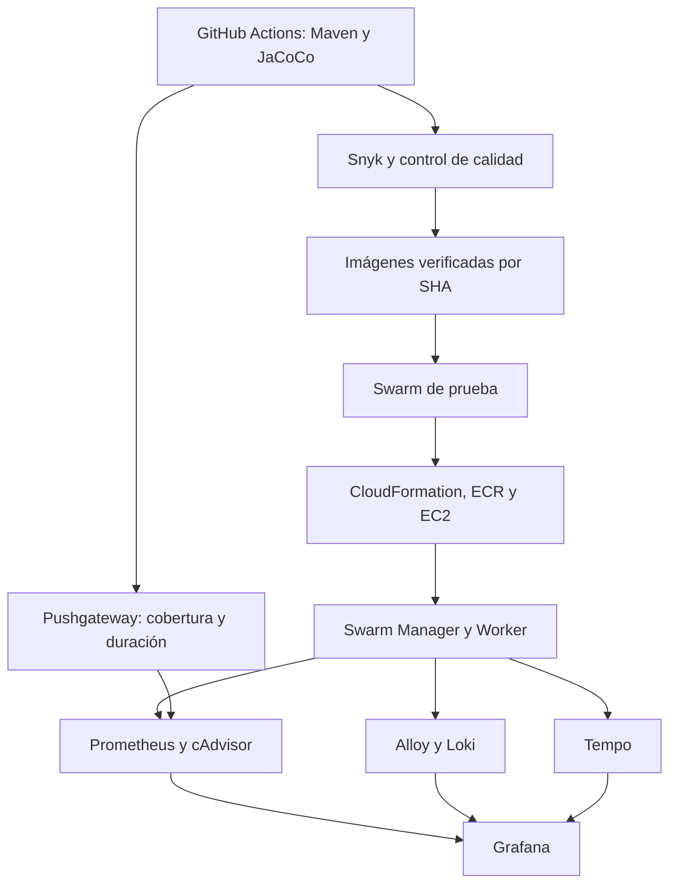

# Observabilidad y entornos reales — EP3 DOY0101

## 1. Alcance y versión comprobada

Proyecto EduBío 360. Rama exclusiva `ep3-devops-cloud`; la entrega Fullstack `nico` y su pila AWS anterior no se modificaron. Pila académica: `edubio-devops-ep3`, us-east-1. Evidencia del 24 de noviembre de 2026 (Chile; 25 de noviembre UTC).

- [CI Java Cloud y Swarm aprobado](https://github.com/Nicricht/edubio360-backend/actions/runs/45518491823), commit `1ace7cc248f6d45805365d49001a41680bd52b2f`.
- [DevSecOps aprobado](https://github.com/Nicricht/edubio360-backend/actions/runs/45518491790), mismo commit.
- [Recuperación AWS, intento 2 aprobado](https://github.com/Nicricht/edubio360-backend/actions/runs/45518492502/attempts/2): imágenes verificadas del commit `c2296701b485be2c557472a7f211c92f34581c13`, configuración de recuperación `1ace7cc2`, frontend `1cb471aaa416a3cf346a40c536506fdbf7dc605a`.
- [Artefacto AWS final](https://github.com/Nicricht/edubio360-backend/actions/runs/45518492502/artifacts/14982145576) y [artefacto CI con capturas Grafana](https://github.com/Nicricht/edubio360-backend/actions/runs/45518491823/artifacts/14978529212).
- [Evidencia de carga y flujo funcional anterior](https://github.com/Nicricht/edubio360-backend/actions/runs/45508192123) (terminó con fallo en Tempo, resuelto en la recuperación final; no se presenta como éxito global).

## 2. Arquitectura e integración

Configuración reproducible: [docker-stack.monitoring.yml](docker-stack.monitoring.yml), [cloud/docker-stack.cloud.yml](cloud/docker-stack.cloud.yml), [observability/](observability/), [workflow Java Cloud](.github/workflows/ep3-cloud.yml), [workflow DevSecOps](.github/workflows/ci.yml), [monitoring-smoke.sh](scripts/ep3/monitoring-smoke.sh), [publish-ci-metrics.sh](scripts/ep3/publish-ci-metrics.sh), [grafana-browser.py](scripts/ep3/grafana-browser.py), [observability-report.py](scripts/ep3/observability-report.py) y [recuperación focalizada](.github/workflows/aws-resume-monitoring.yml). Las sondas, logs, trazas y métricas se comprueban con consultas reales; si no se cumple una condición, el job falla.

## 3. IE1 — logs, uso, errores y disponibilidad (20%)

Datos extraídos de `aws-observability-summary.json` del [artefacto final AWS](https://github.com/Nicricht/edubio360-backend/actions/runs/45518492502/artifacts/14982145576), ventana de logs de 2 horas. `up=1` corresponde a una muestra disponible, no a un SLA. Los contadores HTTP son las muestras observadas en Prometheus, no totales históricos ni necesariamente el número exacto de solicitudes de carga, pues hubo reinicios y cambios de réplicas.

| Servicio | up | Logs 2h | Contador HTTP | HTTP 5xx |
|---|---:|---:|---:|---:|
| Academic | 1 | 8942 | 61 | 1 |
| Analytics | 1 | 4546 | 61 | 0 |
| API Gateway | 1 | 19551 | 202 | 0 |
| Auth | 1 | 8456 | 61 | 0 |
| Discovery | 1 | 11463 | 991 | 0 |
| Guidance | 1 | 3542 | 59 | 0 |
| Import | 1 | 3667 | 60 | 0 |
| Notification | 1 | 3902 | 59 | 0 |

El error HTTP 5xx de Academic permanece registrado; no se confunde con las 384 solicitudes de carga sin errores. El job final comprobó una traza compartida real de Gateway y Academic, logs de los ocho servicios y contadores HTTP de los ocho.

## 4. IE2 — orquestación y observabilidad cloud (20%)

Dos EC2 t3.large en el clúster Swarm, Manager Leader y Worker Ready/Active. Gateway, frontend, Alloy y cAdvisor distribuidos; MySQL y Eureka fijados al Manager. El despliegue no representa alta disponibilidad de base de datos ni del plano de control. La pila real se aprovisionó mediante CloudFormation en el [run original](https://github.com/Nicricht/edubio360-backend/actions/runs/45498949435), y se recuperó sin crear nuevas máquinas. El [run final](https://github.com/Nicricht/edubio360-backend/actions/runs/45518492502/attempts/2) reconfirmó la salud y trazabilidad, constancia de DynamoDB y navegación pública por HTTPS. No se confunde la prueba de un nodo en GitHub con los dos nodos reales de AWS.

### Escalamiento en AWS (evidencia del run 45508192123)

| Servicio | Réplicas | Concurrencia | Solicitudes | Errores | p95 (s) | req/s |
|---|---:|---:|---:|---:|---:|---:|
| Analytics | 1 | 1 | 48 | 0 | 0.117363 | 11.04 |
| Analytics | 1 | 8 | 48 | 0 | 0.272769 | 28.87 |
| Analytics | 2 | 1 | 48 | 0 | 0.074029 | 14.68 |
| Analytics | 2 | 8 | 48 | 0 | 0.291741 | 30.59 |
| Academic | 1 | 1 | 48 | 0 | 0.136682 | 9.12 |
| Academic | 1 | 8 | 48 | 0 | 0.258159 | 31.55 |
| Academic | 2 | 1 | 48 | 0 | 0.126460 | 9.37 |
| Academic | 2 | 8 | 48 | 0 | 0.486172 | 20.90 |

Total 384 solicitudes, cero errores durante estos escenarios. Se verificó la distribución en dos nodos, el registro Eureka y la reducción a una réplica. No se afirma que dos réplicas siempre mejoren el rendimiento: Academic presentó mayor p95 con concurrencia 8 en esta muestra. Es escalamiento controlado por script, no autoescalamiento por umbral.

## 5. IE3 — dashboards integrados al pipeline (10%)

Dashboard provisionado: [observability/edubio.json](observability/edubio.json). El [artefacto CI](https://github.com/Nicricht/edubio360-backend/actions/runs/45518491823/artifacts/14978529212) incluye capturas reales de los siete paneles: disponibilidad, peticiones, errores, cobertura, despliegue, CPU y RAM (archivos `grafana-*.png`). Son capturas del entorno CI, no capturas del navegador de Grafana en AWS. En AWS se verificaron las consultas y API de monitoreo.

| Métrica publicada | Resultado comprobado |
|---|---|
| Duración | 951 segundos (15 min 51 s), etapa AWS anterior, incluye arranque y validaciones; no es duración de arranque puro |
| Cobertura | Gauge JaCoCo publicado: 1.0 para siete módulos instrumentados; verificar alcance con [reportes de pruebas](https://github.com/Nicricht/edubio360-backend/actions/runs/45518491823/artifacts/14979252354); no atribuir 100% a todo el sistema |
| CPU | 24 series observadas de contenedores |
| Memoria | 24 series observadas de contenedores |
| Errores | Contadores de los ocho servicios, incluida la muestra 5xx de Academic |

Las series CPU/memoria son cantidades de series de métricas, no porcentajes de utilización. `deployment-duration-source.txt`, `ci-metrics.prom`, `aws-observability-summary.json` y `cloud-resume.txt` respaldan los resultados. La configuración de Grafana consulta valores de utilización desde Prometheus.

## 6. IE4 — documentación e información para decisiones (10%)

Los archivos y etapas quedan identificados en las secciones 2–5. Para investigar incidencias, el equipo puede correlacionar salud y errores HTTP, consultar logs por servicio en Loki, buscar una traza en Tempo, comparar consumo de CPU/RAM y revisar el tiempo de cada job. Caso factual: el diagnóstico del Worker registró carga elevada y fallos de arranque; se aplicó arranque por etapas. Una recuperación posterior falló en Tempo; se recuperó solo ese servicio, con un límite de memoria de 768 MiB, sin reiniciar los servicios de negocio. [Registro técnico de recuperación](docs/EP3_AWS_RECUPERACION.md).

**Pendiente del equipo:** escribir aquí, con sus propias palabras y sin IA, el análisis de los resultados y la justificación técnica de las decisiones (la pauta lo exige).

## 7. IE5 — políticas de cumplimiento (20%)

[DevSecOps aprobado](https://github.com/Nicricht/edubio360-backend/actions/runs/45518491790): Maven/JaCoCo, Snyk Open Source y Snyk Code, construcción de imagen no-root y smoke test. [Artefacto Snyk](https://github.com/Nicricht/edubio360-backend/actions/runs/45518491790/artifacts/14978558687). El pipeline Java Cloud también exige auditoría npm antes del despliegue real. El umbral Snyk alto/crítico y el bloqueo de calidad se conservan; no se declara certificación de una norma externa que no fue auditada. Los secretos no se guardan en Git, y el stack cloud y la rama están restringidos. AWS Academy usa una sesión temporal.

## 8. IE6 — bloqueo automático (20%)

[Ejemplo histórico de fallo de seguridad](https://github.com/Nicricht/edubio360-backend/actions/runs/45322418192): revisar el job Snyk y las etapas dependientes omitidas. El [workflow DevSecOps](.github/workflows/ci.yml) conecta las etapas mediante `needs`; la auditoría previa a la publicación y aprovisionamiento está también en [ep3-cloud.yml](.github/workflows/ep3-cloud.yml). El fallo de Tempo de la recuperación anterior también impidió la certificación y la prueba de navegador; el aprobado posterior no elimina ese registro. Un job omitido no es una prueba aprobada.

## 9. Cierre y responsabilidad académica

El sistema se comprobó mediante despliegue y recuperación en AWS en ejecuciones enlazadas; no se afirma que el job cloud original haya terminado verde en una sola ejecución. URL académica temporal: https://swakubk30d.execute-api.us-east-1.amazonaws.com. Depende de que AWS Academy esté activo.

Declaración factual de asistencia: ChatGPT se utilizó para revisar requisitos, asistir en la implementación de código, automatización, diagnóstico, documentación y organización de evidencias. El equipo debe verificar, declarar el alcance real y citar el uso según https://bibliotecas.duoc.cl/ia. La pauta DOY0101 permite apoyo de IA en redacción, referencias y diagramas, pero exige ideas, análisis, justificaciones y reflexiones propias; el equipo debe revisar el cumplimiento con el docente, incluido el alcance de la asistencia técnica.

### Conclusiones y reflexiones individuales (obligatorias, sin IA)
- Integrante 1: completar personalmente su aprendizaje y contribución.
- Integrante 2: completar personalmente su aprendizaje y contribución.

No se redactan estas reflexiones ni las justificaciones personales por IA.
